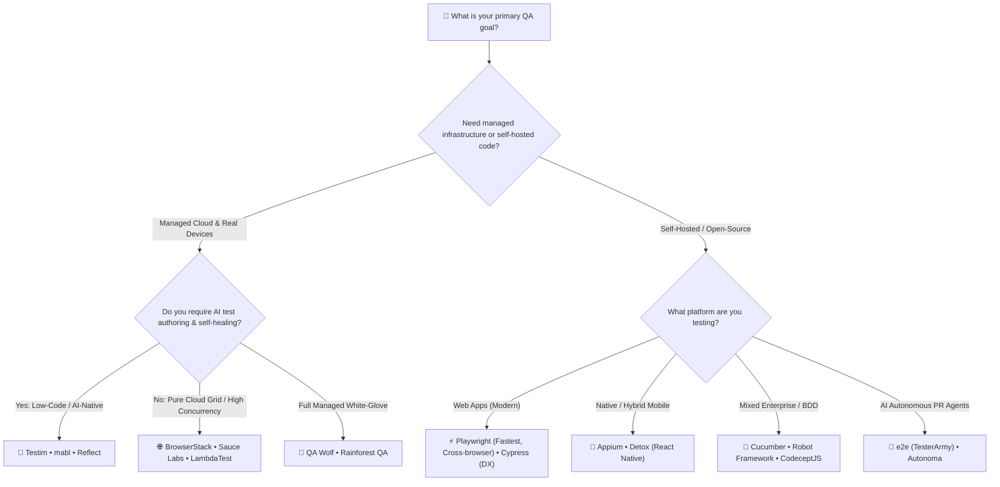

# 🧪 Awesome-End-To-End-Testing

  

  
  
  
  
  
  
  

---

## 📌 Executive Summary & SEO Overview

> **A definitive, community-maintained index of End-to-End (E2E) Testing tools, AI-powered Quality Assurance agents, cloud browser grids, and open-source automation frameworks.**  
> Target Domains: `End-to-End Testing` • `Browser Automation` • `Web & Mobile QA` • `Visual Regression` • `Synthetic Monitoring` • `CI/CD Test Orchestration` • `AI Self-Healing Tests`

**End-to-End (E2E) Testing** validates entire software application flows from end to user interface down to backend databases, microservices, and external third-party integrations. Simulating authentic user behavior ensures critical business flows (such as checkouts, authentications, onboarding, and transactional workflows) perform flawlessly under production-like conditions.

---

## 📑 Table of Contents

- [📊 Sector Overview & Market Dynamics](#-sector-overview--market-dynamics)
- [☁️ SaaS & Managed Cloud Testing Platforms](#️-saas--managed-cloud-testing-platforms)
- [💻 Open-Source Test Automation Frameworks](#-open-source-test-automation-frameworks)
- [🧠 Choosing the Right Tool: Architecture & Fit](#-choosing-the-right-tool-architecture--fit)
- [🤝 How to Contribute](#-how-to-contribute)
- [💖 Support & Community](#-support--community)
- [ Star History](#--star-history)
- [⚖️ Disclaimer](#️-disclaimer)

---

## 📊 Sector Overview & Market Dynamics

The global automated software testing and quality engineering market is estimated at **$28.5 billion to $35 billion**, projected to expand at an annual compound growth rate (CAGR) of **15%–18%** to exceed **$65+ billion by 2032**. 

The sector displays **moderate to high fragmentation** rather than a winner-take-all monopoly: while legacy enterprise budgets remain concentrated among established device clouds (e.g., Tricentis, BrowserStack, and Sauce Labs), the rapid dominance of open-source engines like Playwright alongside the rise of autonomous AI test agents (self-healing locators, natural language test authoring, and synthetic preview environment runners) has fragmented the ecosystem into specialized, high-growth categories.

---

## ☁️ SaaS & Managed Cloud Testing Platforms

The following table benchmarks category-leading hosted SaaS platforms, cloud device farms, and visual regression solutions. The table is sorted in descending order by **Company Scale (Valuation / Revenue)**.

| 🏷️ Platform | 📝 Description & Core Focus | 🏢 Company Scale (Valuation / Revenue) | 💵 Starting Pricing (Specific Tiers) | 🎁 Free Tier / Free Trial Limits |
| :--- | :--- | :--- | :--- | :--- |
| **[Testim (Tricentis)](https://www.testim.io/)** | 🤖 AI-powered low-code UI and mobile test automation with machine learning locator self-healing and enterprise test governance. | **$4.5B Valuation**   (~$500M ARR) | **$450 / month**   (Base parallel execution tier; enterprise contracts from ~$10,000/year) | **Free Community Tier:** 1,000 test runs/month; or 14-day fully-featured evaluation trial. |
| **[BrowserStack](https://www.browserstack.com/)** | 🌐 World's largest real device cloud and cross-browser testing matrix with automated regression (Automate) and visual AI testing (Percy). | **$4.0B Valuation**   (~$230M ARR) | **$12.50 / month**   (Live Manual, billed annually) or $29/mo (monthly); Automate tier from **$199 / month** | **Percy Free Plan:** 5,000 visual screenshots/month forever; **Live/Automate Trial:** 100 mins automated mobile + 30 mins interactive browser. |
| **[Reflect (SmartBear)](https://reflect.run/)** | 🔍 Zero-installation, cloud-native web testing engine with generative AI test authoring, visual validation, and developer API dispatch. | **$1.8B+ Valuation**   (~$150M–$500M Revenue) | **$99 / month**   (Starter credit package); **$450 / month** (Premium tier with 5,000 monthly credits) | **14-day free trial** with full feature access, unlimited test creation, and unlimited team seats. |
| **[Sauce Labs](https://saucelabs.com/)** | 🧪 Pioneer enterprise continuous testing cloud offering real device infrastructure, emulator farms, error reporting (Backtrace), and Sauce AI. | **~$500M Valuation**   (~$80M–$100M Revenue, $272M funded) | **$39 / month**   (Live Testing, billed annually) or **$149 / month** (Virtual Device Cloud automated testing) | **28-day free trial:** includes 60 total minutes of automated/live testing across 3 parallel virtual machines with Sauce AI. |
| **[LambdaTest](https://www.lambdatest.com/)** | ⚡ High-speed AI-assisted cloud testing platform with HyperExecute parallel orchestration and KaneAI agentic test generation. | **$400M Valuation**   (~$19M Revenue, $108M funded) | **$15 / month**   (Live Interactive Cross-Browser, annual) or **$35 / month** (Web Automation, annual) | **Free Forever Plan:** 60 minutes/month of live testing (10-min sessions), 1 parallel test thread, and 100 screenshot tests/month. |
| **[mabl](https://www.mabl.com/)** | 🧠 Intelligent low-code continuous testing platform integrating browser, API, mobile, accessibility, and automated regression tracking. | **~$400M Valuation**   (~$20M ARR, $76M funded) | **$450 / month**   (Starter tier bundling 500 monthly cloud-test runs with unlimited local CLI runs) | **14-day free trial:** includes 500 cloud test executions, unlimited local CLI runs, and low-code test creator access. |
| **[Applitools](https://applitools.com/)** | 👁️ The industry benchmark for Visual AI testing; identifies layout bugs, visual drift, and cross-browser visual regressions across apps. | **$250M Valuation**   (Thoma Bravo acquired; ~$30M–$50M Rev) | **$667 / month**   (Starter tier billed annually at ~$8,000/year for 50 Test Units) | **14-day free trial:** up to 50 Test Units (~1,000 page checkpoints or 100,000 component checkpoints). |
| **[QA Wolf](https://www.qawolf.com/)** | 🐺 Hybrid AI + human managed service providing 80% automated test coverage in Playwright with zero vendor lock-in and zero seat licenses. | **~$175M Valuation**   (~$18M ARR, $57M funded) | **$0 base + usage**   ($0.01 per AI credit, $0.15 per runner minute); Managed service starts at **~$40 / test / month** | **14-day free trial** on self-serve platform with 100 free runner minutes and full Playwright test export. |
| **[Rainforest QA](https://www.rainforestqa.com/)** | 🚀 No-code automated testing combined with on-demand human crowd-testing for fast exploratory verification and regression coverage. | **~$80M Valuation**   (~$25M ARR, $41M funded) | **$200 / month**   (Pay-As-You-Go platform base fee) + $5/hour for automated AI runs ($25/hr crowd-testing) | **Free Essentials Tier:** 5 hours of automated cloud browser testing per month; or 14-day trial with 100 automated test runs. |

---

## 💻 Open-Source Test Automation Frameworks

The following open-source frameworks power custom in-house testing pipelines, CI/CD runners, and headless automation grids. Every project is sorted descending by **GitHub Star Count**, and each badge links directly to the repository's stargazers community page.

1. **[Playwright](https://github.com/microsoft/playwright)**   
   🚀 Microsoft's modern standard for end-to-end web testing. Features native multi-browser support (Chromium, Firefox, WebKit), auto-waiting, resilient locators, built-in network mocking, parallel execution, and the interactive Trace Viewer for time-travel DOM inspection. Supports TypeScript, JavaScript, Python, .NET, and Java.

2. **[Puppeteer](https://github.com/puppeteer/puppeteer)**   
   🤖 Google Chrome team's headless browser automation library communicating over the Chrome DevTools Protocol (CDP) and WebDriver BiDi. High performance for synthetic monitoring, page scraping, PDF generation, and lightweight E2E validation.

3. **[Cypress](https://github.com/cypress-io/cypress)**   
   🌲 Developer-centric testing framework running directly in the browser runtime loop. Renowned for its DX (developer experience), real-time reloads, automatic snapshot debugging, and intuitive API for front-end application verification in JavaScript/TypeScript.

4. **[Selenium](https://github.com/SeleniumHQ/selenium)**   
   🌐 The foundational open-source automation standard driving W3C WebDriver specifications. Offers multi-language bindings (Java, Python, C#, Ruby, JavaScript) with an unparalleled global ecosystem and backward compatibility for enterprise test estates.

5. **[Appium](https://github.com/appium/appium)**   
   📱 The cross-platform mobile automation standard for native, hybrid, and mobile-web apps across iOS, Android, and desktop operating systems. Plugs directly into real-device farms and emulators using standard WebDriver endpoints.

6. **[Detox](https://github.com/wix/Detox)**   
   ⚡ Gray-box end-to-end testing and automation library for React Native and native mobile applications. Synchronizes with app internal threads to eliminate flakiness in mobile CI pipelines.

7. **[Robot Framework](https://github.com/robotframework/robotframework)**   
   🤖 Generic Python-based keyword-driven test automation framework. Excellent for cross-functional teams where product owners and manual QA author readable tests while engineers write Python/Java keywords.

8. **[Nightwatch.js](https://github.com/nightwatchjs/nightwatch)**   
   🌙 Integrated Node.js end-to-end testing framework with native support for W3C WebDriver and Chrome DevTools Protocol. Features a built-in test runner, component testing, and visual regression plugins.

9. **[e2e (TesterArmy)](https://github.com/tester-army/e2e)**   
   🧠 AI-native hybrid testing framework for web and mobile (TypeScript, Apache-2.0). Combines deterministic code assertions with dynamic `agent.act()` natural language instructions, featuring smart action replay caching to slash token costs.

10. **[TestCafe](https://github.com/DevExpress/testcafe)**   
    ☕ Pure NodeJS end-to-end testing tool that executes without browser plugins or WebDriver binaries. Features automatic waiting, isolated test execution, and concurrent multi-browser execution.

11. **[WebdriverIO](https://github.com/webdriverio/webdriverio)**   
    🔌 Next-gen browser and mobile automation framework for Node.js. Supports both WebDriver and Chrome DevTools Protocol, with plugins for Cucumber, Jasmine, Mocha, and major cloud providers.

12. **[Cucumber.js](https://github.com/cucumber/cucumber-js)**   
    🥒 The official JavaScript implementation of Cucumber and Gherkin syntax. Facilitates Behavior-Driven Development (BDD), enabling non-technical stakeholders to write executable human-readable user stories.

13. **[CodeceptJS](https://github.com/codeceptjs/CodeceptJS)**   
    🎯 Scenario-driven multi-backend testing framework. Provides a unified, high-level actor API (`I.amOnPage`, `I.click`) that can interchangeably run on top of Playwright, Puppeteer, WebDriverIO, or Appium.

14. **[Gauge](https://github.com/getgauge/gauge)**   
    📐 ThoughtWorks' lightweight, cross-platform test automation engine with Markdown-based specifications. Integrates with Java, Python, C#, and JavaScript for maintainable test suites.

15. **[Selenoid](https://github.com/aerokube/selenoid)**   
    🐳 Lightweight Golang-based implementation of the Selenium hub running browsers inside isolated Docker containers. Consumes a fraction of the RAM of standard Selenium Grids with sub-second browser startup.

16. **[Autonoma](https://github.com/Autonoma-AI/autonoma)**   
    🤖 Agentic autonomous testing system that reads repository pull requests, launches isolated preview environments, navigates workflows in real browsers, and self-heals when user interfaces change.

---

## 🧠 Choosing the Right Tool: Architecture & Fit

---

## 🤝 How to Contribute

Contributions are warmly encouraged! To propose a new framework, update pricing/scale details, or fix inaccuracies:

1. 🍴 **Fork the repository** to your personal GitHub account.
2. 🌿 **Create a dedicated branch** (`git checkout -b feature/add-new-e2e-tool`).
3. 📝 **Add or edit entries in `README.md`**:
   - For SaaS additions: include product name, URL, short summary, company scale (valuation/revenue), specific starting tier price, and specific free tier limits.
   - For Open-Source additions: include repository name, URL, exact star badge with `style=social&color=white` linking to the stargazers page, and maintain proper descending star sort order.
4. 🚀 **Commit your changes** (`git commit -m "feat: add {tool_name} to e2e directory"`).
5. 📤 **Push to your fork** (`git push origin feature/add-new-e2e-tool`).
6. 🎯 **Open a Pull Request** with a concise explanation.

⭐ **Star this repository** if it helped you navigate the end-to-end testing landscape!

---

## 💖 Support & Community

Thank you for visiting and supporting the **Awesome End-To-End Testing** open-source initiative! If you find this curated directory useful for your work or team:

- ⭐ **Star this repository** to help others discover quality engineering resources on GitHub.
- 🍴 **Fork and share** the repo across your QA guilds, developer channels, and newsletters.
- ☕ **Support the maintainer**: If you would like to buy a coffee or sponsor continuous research and ecosystem tracking, please visit the [GitHub Sponsors Dashboard](https://github.com/sponsors/ishandutta2007).

  

---

##  Star History

---

## ⚖️ Disclaimer

- This list is independently curated by software engineers for educational and informational purposes. It is not sponsored by any vendor.
- Company valuations, revenues, and pricing tiers reflect publicly disclosed venture rounds, SEC/registry filings, and vendor pricing pages as of late 2024–2026. Verify current quotes directly with respective vendors.
- End-to-end tests are resource-intensive: engineering teams should focus automated suites around critical user paths (golden flows) to keep CI/CD pipelines swift and reliable.

---

  <b>Built with ❤️ for QA Engineers, DevOps Architects &amp; Software Craftspeople worldwide.</b>

